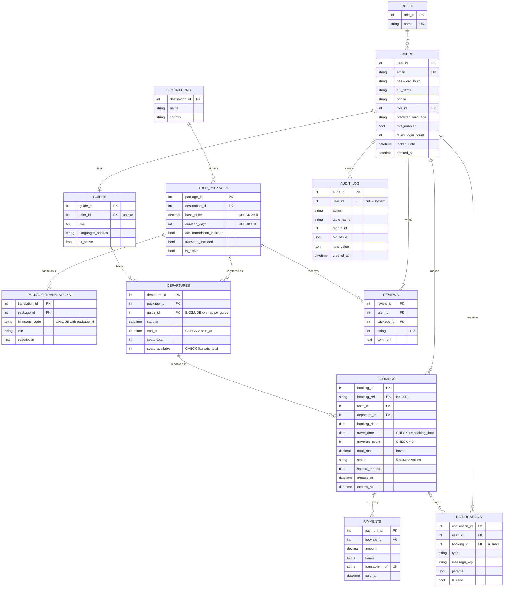

# ER diagram (Mermaid)  - Owner: Elza (Data & Database) / Amina S. (slide)

> On the ER slide the `USERS` entity is labelled **"CUSTOMERS / users"** (tourists are users with role = tourist).
> 12 entities, PK/FK marked. All foreign keys are `ON DELETE RESTRICT` (deactivate, never delete).

