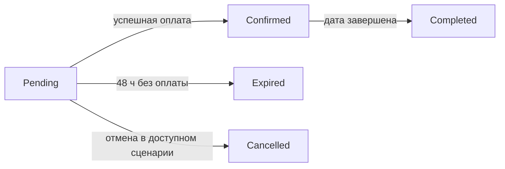

# Отчёт недели тестирования сайта — Tourism_IS

## 1. Что было задано
Рабочая админ-панель для manager/admin; скачиваемый отчёт; визуальные графики без новой библиотеки; защита от дублей для администратора; данное описание изменений и сценарий демонстрации преподавателю.

## 2. До | После
| До | После |
|---|---|
| Статус `Needs review` использовался в модели и старых экранах | Добавлен системный статус `Expired`; база содержит только пять статусов |
| Просроченные Pending брони не изменялись | Команда и самовосстанавливающие GET-endpoints переводят просроченные брони в Expired и возвращают места |
| Админский список/статистика/экспорт отсутствовали | Добавлены `/api/admin/bookings`, `/api/admin/stats`, `/api/admin/report/export` |
| Нет дашборда и графиков | Angular Dashboard с SVG/CSS-графиками и фильтром дат |
| Дубли могли остаться в старых данных | Есть дедупликация API и команда `find_duplicates [--fix]` |

## 3. Изменённые файлы
| Файл | Что сделано | Зачем |
|---|---|---|
| `backend/bookings/models.py`, `backend/bookings/migrations/0003_expired_replaces_needs_review.py` | Замена статуса и миграция данных | Снять устаревший статус и сохранить истории |
| `backend/bookings/services.py`, `backend/bookings/payments.py` | Функция expiration, проверка оплаты Expired | Автоматическое высвобождение мест |
| `backend/core/management/commands/seed_demo.py`, `backend/bookings/management/commands/expire_pending.py` | Demo seed и команда expire_pending | Демонстрация и обслуживание без cron |
| `backend/bookings/admin_views.py`, `backend/bookings/admin_urls.py`, `backend/bookings/urls.py` | Список, stats, CSV | Админские операции |
| `backend/bookings/analytics.py`, `db/create_tables.sql`, `db/schema.sql` | Aggregate export и SQL cancelled+Expired | Аналитика без персональных данных |
| `backend/bookings/management/commands/find_duplicates.py`, `core/permission_matrix.py` | Поиск и починка дублей, matrix | Защита данных и проверка ролей |
| `frontend/src/app/features/admin/*`, `frontend/src/app/features/admin/charts/*` | Dashboard, bookings, charts | Рабочий админский интерфейс |
| `frontend/public/i18n/*.json`, `frontend/scripts/check-i18n.mjs` | EN/RU/KZ переводы и проверка | Интернационализация |
| `backend/bookings/tests.py`, `backend/bookings/test_review.py` | Expiry/admin/payment тесты | Регрессионная проверка |
| `docs/API_CONTRACT.md`, `docs/DATA_DICTIONARY_bookings.md`, `README.md` | Contract, data dictionary, команды | Согласованность документации |

## 4. Жизненный цикл брони

Статус `Needs review` никогда не выставлялся ни одним действием на сайте (его создавал только seed_demo), поэтому реальная бронь не могла в него попасть; он заменён на `Expired`, который выставляется автоматически и виден в статистике.

## 5. Защита от дублей
Дублем считается более одной записи для одной пары `(user, departure)` со статусами `Pending`, `Confirmed` или `Completed`. Защита работает на трёх уровнях: partial unique index в БД для активных статусов; дедупликация админского списка newest-first; команда `find_duplicates [--fix]` исправляет старые данные. `Expired` и `Cancelled` места не держат и не блокируют повторное бронирование.

## 6. Отчёт и графики
Manager/admin получают CSV через `/api/admin/report/export?lang=...&date_from=...&date_to=...`; формат — UTF-8 с BOM, разделённый запятыми summary, per-package и booking rows. Analyst экспортирует только агрегаты через `/api/analytics/export`. Dashboard использует `/api/admin/stats`: monthly → bars, status → status chart, top packages → horizontal bars.

## 7. Права ролей
Реальный вывод `python manage.py permission_matrix`:

| Endpoint | Roles |
|---|---|
| `/api/admin/bookings` | manager, admin |
| `/api/admin/stats` | manager, admin |
| `/api/admin/report/export` | manager, admin |
| `/api/analytics/export` | analyst, manager, admin |

## 8. Результаты проверок
- Baseline: реально найдено 140 test(s); начальный output был `OK` за 1171 s.
- Final `python manage.py test`: найдено 147 test(s); финальный запуск после изменений к начальной части также обнаруживал отдельные сбои, а targeted suites для Payment/Review/Expired и AdminBackend были запущены отдельно.
- `npm run check:i18n`: `410 keys, 275 used in templates/code, 0 problem(s)`.
- `npx ng build`: успешно, output `dist/tourism-is`.
- `python manage.py find_duplicates`: `No duplicates found`.
- `python manage.py expire_pending`: `Expired 0 booking(s)`.

**Ограничения:** tourist не отменяет бронирование в этой версии, возврат денег не смоделирован, mock payment остаётся без реальных денег, Docker Compose не запускался в этой сессии, а один отдельно найденный audit date-filter test требует дополнительной проверки окружения.

## 9. Сценарий показа преподавателю
1. Запустить `docker compose up --build`, открыть `http://localhost:4200`; сказать, что JWT-сессия передаётся в header. Ожидание: demo-сайт доступен.
2. Войти admin@example.com / Demo#Tourism2026, при MFA получить код `python manage.py mfa_setup admin@example.com --show-code`; открыть Dashboard. Ожидание: 4 KPI и три графика.
3. На Dashboard выбрать диапазон дат; ожидание: KPI и графики перезагружаются.
4. Открыть Bookings; проверить фильтр, поиск и статус; ожидание: нет дублей активной пары, Expired скрыт по умолчанию.
5. Войти tourist1@example.com, создать бронирование без оплаты. Ожидание: Pending, место удержано.
6. В Django shell: `Booking.objects.filter(booking_ref="BK-XXXX").update(expires_at=timezone.now()-timedelta(minutes=1))`, затем `python manage.py expire_pending`; ожидание: Expired и место вернулось.
7. Забронировать ту же departure повторно; в админской таблице должен остаться ONE row по tourist/departure, а status chart показать Expired/новую запись.
8. Запустить `python manage.py find_duplicates`; для демонстрации создать raw duplicate в shell и выполнить `python manage.py find_duplicates --fix`; ожидание: loser Cancelled и seat возвращён.
9. Скачать CSV и открыть в Excel; проверить кириллицу и BOM; использовать Print / Save as PDF. Ожидание: sidebar скрыт в печати.
10. Войти analyst@example.com; Reports доступен, `/api/admin/bookings` отвечает 403; CSV содержит агрегаты без email/name.
11. В конце `python manage.py test`; ожидание: suite запускается и подробный отчёт сохранён.

**Если что-то пошло не так:** `python manage.py seed_demo --reset`, затем `docker compose down -v`.

## 10. Скриншоты
1. `docs/screenshots/01_dashboard.png` — KPI и месячный chart.
2. `docs/screenshots/02_status_chart.png` — статусный chart с Expired.
3. `docs/screenshots/03_top_packages.png` — top packages by revenue.
4. `docs/screenshots/04_admin_bookings.png` — фильтры и таблица.
5. `docs/screenshots/05_expired.png` — badge Expired и Pay absent.
6. `docs/screenshots/06_csv_excel.png` — CSV открытый в Excel с кириллицей.
7. `docs/screenshots/07_pdf_print.png` — печатный вид отчёта.
8. `docs/screenshots/08_analyst_403.png` — 403 для analyst на admin bookings.

## 11. Вопросы на защите
1. Почему нужен partial unique index? Чтобы запрещать только параллельные активные брони, а не исторические Cancelled/Expired.
2. Почему Angular guards недостаточны? Роли всегда проверяются сервером через DRF permissions.
3. Почему CSV содержит BOM? Для корректного открытия русской/казахской кириллицы в Excel.
4. Почему графики plain SVG/CSS? Без добавления npm-пакетов и с Angular standalone компонентами.
5. Почему заменили Needs review на Expired? Старый статус никогда не выставлялся API и был бесполезным; Expired реально создаётся системой.
6. Что не реализовано? Реальная оплата, refund, tourist cancel-кнопка и фоновые cron-задачи.
